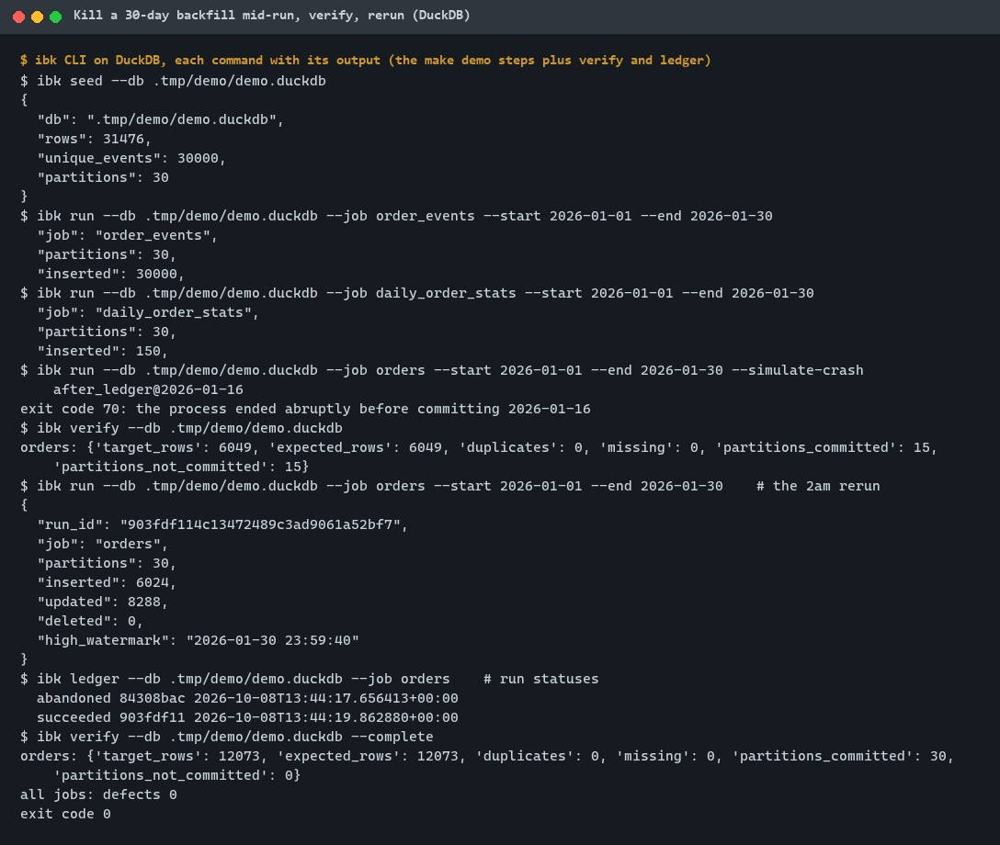
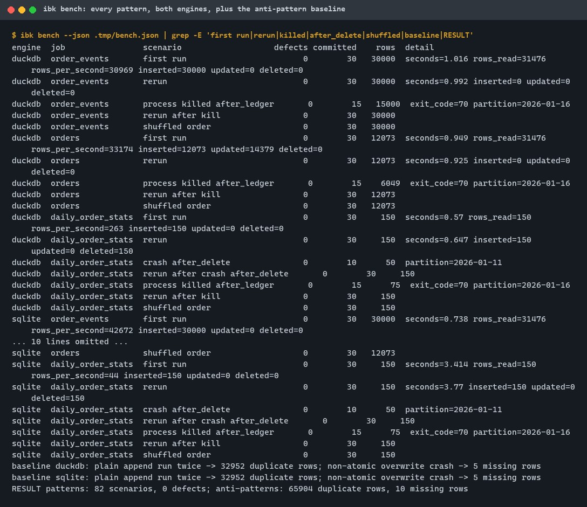
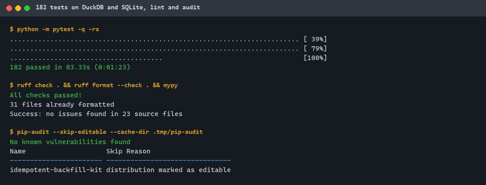
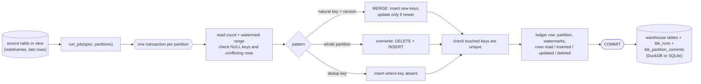
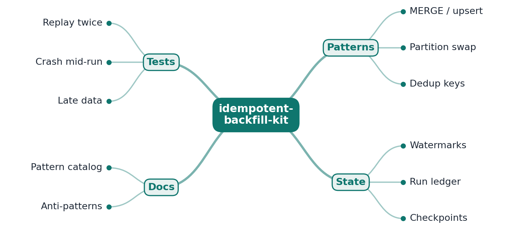
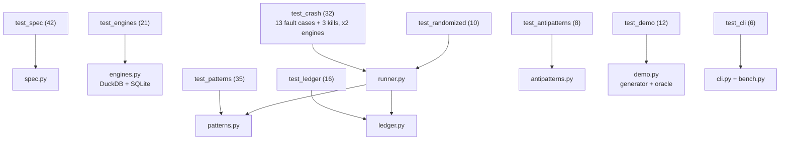

# idempotent-backfill-kit

[](https://github.com/EquinoxWN/idempotent-backfill-kit/actions/workflows/ci.yml)


> Makes re-running a pipeline safe (no duplicates, no gaps), so a 2am rerun never corrupts the warehouse.

Part of my **Data Engineering** list · Python

## Proof it works

A backfill of 30 days is killed before it commits 2026-01-16. The warehouse then holds exactly
the 15 committed days (0 duplicates, 0 missing rows), the ledger says so, and the rerun completes
the job: 12,073 orders, 0 defects across all three jobs.



`ibk bench` runs every pattern on DuckDB and SQLite through first runs, reruns, crashes at every
fault point, killed processes and shuffled partition orders: 82 scenarios, 0 defects. The same
source through the two common anti-patterns: 32,952 duplicate rows from a plain append run twice,
and a missing day from a non-atomic overwrite, per engine.



182 tests pass on both engines; ruff, mypy `--strict` and pip-audit are clean:



## Architecture

**What M1 runs today:**



**Full roadmap (M1 to M3):**



## How it works

_Steps 1 and 2 are built and tested (M1); the rest is on the [roadmap](#roadmap)._

1. Every job writes through one of three idempotent patterns: MERGE on natural keys, atomic partition overwrite, or insert with a dedup key.
2. A run ledger records which partitions and watermarks each run processed.
3. After a restart, the job resumes from the last committed watermark instead of guessing.
4. Replay tests run each job twice on the same input and assert identical output.
5. Crash tests kill the job mid-write and verify no partial data becomes visible.
6. The catalog explains when to use each pattern, and which anti-patterns (plain appends on rerun) cause duplicates.

| Pattern | Use it for | Why a rerun is safe |
|---|---|---|
| MERGE on natural keys | entities that change over time (orders, customers) | only a strictly newer version updates a row; equal or older versions change nothing, so partitions can run in any order (ADR 0003) |
| Atomic partition overwrite | derived tables recomputed per day (daily aggregates) | the partition's `DELETE` and `INSERT` commit together; an empty source cannot wipe a partition unless asked |
| Insert with a dedup key | append-only facts with an event id | exact redeliveries collapse and keys already present are skipped; a key arriving with different content stops the run |

Each partition's write and its ledger row share one transaction (ADR 0002), and every key the
partition touched is checked for a single row before the commit (ADR 0004).

## Who it helps

- **Who:** Data and analytics engineers who own scheduled loads and backfills, and whoever is on
  call when one fails at night.
- **The problem:** Rerunning a failed load appends duplicates or leaves an emptied partition, and
  nobody knows which days actually finished.
- **How to use it:** Describe each job (source, target, key, partition and watermark columns,
  pattern) in Python or a TOML file and run it with `ibk run` over a date range. Rerun the same
  command after any failure; `ibk ledger` shows which partitions and watermarks each run
  committed, and the crash drill (`--simulate-crash`) lets you rehearse a failure before it
  happens for real.

## Tech stack

| Area | In M1 | Planned |
|---|---|---|
| Core | Python 3.11+, DuckDB 1.5 (`MERGE INTO`), SQLite (`ON CONFLICT`), run ledger in the warehouse | resume from the last committed watermark (M2) |
| Test | pytest, crash injection at 5 fault points, killed processes, seeded random histories, independent oracle | replay tests (M2), external kills at random moments (M3) |
| Docs | RFC, 4 ADRs, M1 results with DMAIC | pattern catalog with anti-patterns (M3) |

Language: **Python** (3.11+). Code in [`src/idempotent_backfill_kit/`](src/idempotent_backfill_kit):
`spec.py` (job specs and validation), `engines.py` (DuckDB and SQLite), `patterns.py` (the three
writes and their checks), `ledger.py`, `runner.py` (transactions and fault points), `demo.py`
(seeded source, demo jobs, oracle), `antipatterns.py` (baseline only), `bench.py`, `cli.py`.

## Run it

**Prerequisites:** Python 3.11+ and `make`. No database server and no Docker: DuckDB installs as a
wheel and SQLite ships with Python.

```bash
python -m venv .venv && source .venv/bin/activate   # Windows: .venv\Scripts\activate
make setup     # install the package and dev tools (exact versions from constraints.txt)
make lint      # ruff, ruff format, mypy --strict
make test      # 182 tests on DuckDB and SQLite (about 1.5 minutes)
make demo      # seed, run three jobs, crash one mid-run, rerun, verify
make bench     # 82 scenarios plus the anti-pattern baseline (about 1.5 minutes)
make audit     # pip-audit
```

Step by step with the CLI (the file suffix picks the engine: `.duckdb`, or `.sqlite`/`.db`):

```bash
ibk seed   --db wh.duckdb                         # 30 days of order events, about 5% redelivered
ibk run    --db wh.duckdb --job orders --start 2026-01-01 --end 2026-01-30 \
           --simulate-crash after_ledger@2026-01-16   # exits with code 70 before that day commits
ibk verify --db wh.duckdb                         # 15 days visible, 0 duplicates, 0 missing
ibk run    --db wh.duckdb --job orders --start 2026-01-01 --end 2026-01-30   # the rerun
ibk ledger --db wh.duckdb --job orders            # runs (abandoned, succeeded) and partitions
```

Your own jobs, in a TOML file (`ibk run --jobs jobs.toml --job orders ...`):

```toml
[[job]]
name = "orders"
pattern = "merge"                # merge | overwrite | dedup_insert
source = "src_order_events"      # table or view
target = "dim_orders"
columns = ["order_id", "version", "status", "amount_cents", "event_time"]
partition_column = "event_date"  # daily partitions, YYYY-MM-DD
watermark_column = "event_time"
key = ["order_id"]
version_column = "version"       # merge only: newer versions win
```

## Tests and results

Full numbers and commands: [docs/results/m1.md](docs/results/m1.md).

| Test file | Tests | What it proves |
|---|---|---|
| `test_spec.py` | 42 | unsafe identifiers, pattern rules, partition values and job files are rejected before any SQL runs |
| `test_engines.py` | 21 | commits survive reopening, rollbacks and unfinished transactions do not; row counts; bulk loading of awkward text; newer-wins upsert on both engines |
| `test_patterns.py` | 35 | each pattern: reruns change nothing, older versions never win, conflicting or NULL keys and empty overwrites fail before writing, duplicates can never be committed |
| `test_ledger.py` | 16 | partitions, watermark ranges and row counts recorded exactly; failed and abandoned runs; gaps and high watermark as queries; no ledger row outside the data's transaction |
| `test_crash.py` | 32 | every job x every fault point x both engines: after a crash exactly the committed partitions are visible, and a rerun completes with 0 defects; 6 killed processes |
| `test_randomized.py` | 10 | 4 seeds x 2 engines of random partial runs, crashes, late data and reruns, all three targets checked after every step; late data is a visible gap until rerun |
| `test_antipatterns.py` | 8 | the baseline: plain appends duplicate, a non-atomic overwrite leaves a gap; the patterns do not |
| `test_demo.py` | 12 | the seeded generator and the independent oracle |
| `test_cli.py` | 6 | `seed`, `run`, `verify`, `ledger`, `bench` end to end, exit codes, a simulated crash and rerun, custom TOML jobs |

| Check | Result |
|---|---|
| Tests (`make test`) | **182 passed**, 0 failed, 0 skipped (Windows 11, Python 3.14, DuckDB 1.5.6, SQLite 3.50.4) |
| Quality check (10 rules, 12 mutants) | 12 of 12 killed, see [docs/quality/2026-11-01.md](docs/quality/2026-11-01.md) |
| Benchmark (`make bench`) | **82 scenarios, 0 defects** on 31,476 source rows per engine (30,000 unique events, 30 days) |
| Reruns of unchanged input | MERGE: 0 inserted, 0 updated; dedup insert: 0 inserted; overwrite: 150 deleted and 150 inserted (by design) |
| After a crash or a killed process | the ledger lists exactly the partitions whose data is visible, in all 32 crash scenarios |
| Baseline anti-patterns | plain append run twice: 32,952 duplicate rows; non-atomic overwrite crash: 5 missing rows (per engine) |
| Run time, 30 partitions | DuckDB 0.6 to 1.0 s per job; SQLite 0.6 to 0.7 s (3.4 s for the overwrite's aggregate view) |
| Defect found and fixed | DuckDB 1.5.6 unique indexes missed WAL-replayed rows after an unclean exit (42 duplicates in a rerun); now no DuckDB indexes plus a transactional key check (ADR 0004) |
| Lint / audit | ruff, mypy `--strict` clean; `pip-audit`: no known vulnerabilities |

### Test map



## Roadmap

**M1** (≈8 h)
- [x] Write `docs/rfc/0001-design.md`: problem, goals, non-goals, chosen design
- [x] Every job writes through one of three idempotent patterns: MERGE on natural keys, atomic partition overwrite, or insert with a dedup key.
- [x] A run ledger records which partitions and watermarks each run processed.

**M2** (≈8 h)
- [ ] After a restart, the job resumes from the last committed watermark instead of guessing.
- [ ] Replay tests run each job twice on the same input and assert identical output.

**M3** (≈9 h)
- [ ] Crash tests kill the job mid-write and verify no partial data becomes visible.
- [ ] The catalog explains when to use each pattern, and which anti-patterns (plain appends on rerun) cause duplicates.
- [ ] Publish the proof below with real numbers

## Proof

What this repo must show before it counts as done:

- Replay and crash test results for every pattern.

| Result | Value |
|---|---|
| M3 proof above | Not complete yet (M3). Current M1 numbers: 82 benchmark scenarios with 0 defects, 32 crash scenarios in the tests; see [Tests and results](#tests-and-results). |

## Why it matters

- **Interview angle:** 'Make a batch job safe to retry'.
- **Upstream I'd like to contribute to:** Apache Iceberg MERGE docs and tests; and a report to DuckDB with the index reproduction in [`scripts/`](scripts/duckdb_index_after_unclean_exit.py).

## Design docs

- [RFC 0001: design](docs/rfc/0001-design.md)
- [ADR 0001: record architecture decisions](docs/adr/0001-record-architecture-decisions.md)
- [ADR 0002: keep the run ledger in the data's transaction](docs/adr/0002-ledger-in-the-data-transaction.md)
- [ADR 0003: version-gated MERGE](docs/adr/0003-version-gated-merge.md)
- [ADR 0004: no DuckDB unique indexes; check touched keys in the transaction](docs/adr/0004-no-duckdb-unique-index-check-keys-in-transaction.md)
- [M1 results](docs/results/m1.md)

## Scope

This is a learning and portfolio system, not a hosted production service. Everything runs locally.

## Security and contributing

- Table and column names must match a strict identifier pattern and are quoted; every value is a bound parameter; partitions must be calendar dates; job files have exact keys and a size cap.
- Every GitHub Action is pinned to a commit SHA; workflows run read-only, without persisted credentials; dependencies install from `constraints.txt`.
- Dependabot update pull requests are paused (`open-pull-requests-limit: 0`) so the repository keeps a single `main` branch; dependencies are updated by hand and checked by the CI audit; CI runs `pip-audit` on every push.
- Report vulnerabilities privately: see [SECURITY.md](SECURITY.md). To contribute, see [CONTRIBUTING.md](CONTRIBUTING.md).

## License

MIT, see [LICENSE](LICENSE).
