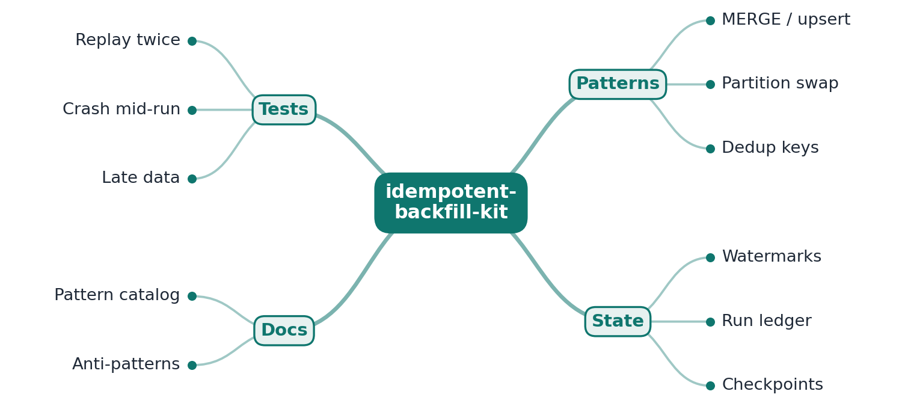

# RFC 0001: idempotent-backfill-kit design

- **Status:** Accepted (M1 implemented)
- **Author:** EquinoxWN
- **Created:** 2026

## Problem

A batch job that loads a warehouse fails at 2am halfway through a 30-day backfill. Whoever is on
call reruns it. If the job appends rows, every partition it had already written is now in the
table twice. If it replaces a partition with a `DELETE` and an `INSERT` that commit separately,
a crash between the two leaves that day empty. If nobody recorded which days were finished,
the rerun either repeats everything or someone guesses where to restart. Upstream data makes it
worse: sources deliver the same event more than once, and late events land in days that were
already processed. The result is a warehouse whose numbers depend on how often and where a job
crashed.

**Who has this problem:** data engineers and analytics engineers who own scheduled loads and
backfills, and the on-call person who has to rerun them.

## Critical-to-quality measures (Define)

| CTQ | Measure | Target (M1) |
|---|---|---|
| No duplicates | rows whose key appears more than once, after any run, rerun or crash plus rerun | 0 |
| No gaps | expected rows missing from a target after a complete rerun | 0 |
| No partial partitions | after a crash, rows visible beyond exactly the partitions the ledger marks committed | 0 |
| Ledger matches data | crash scenarios where the ledger's committed partitions differ from the visible data | 0 |
| Cheap reruns | rows a rerun of unchanged input changes (merge and dedup insert) | 0 |
| Fail fast on unsafe input | NULL keys, a key or key/version reused with different content, or an overwrite that would empty a partition: committed anyway | 0 |

Each target is checked by tests on two engines and by `ibk bench` (see the measurement plan).

## Goals

- Every job writes through one of three idempotent patterns: MERGE on natural keys, atomic
  partition overwrite, or insert with a dedup key.
- A run ledger records which partitions and watermarks each run processed, in the same
  transaction as the data, so it can never claim more or less than what is visible.
- Both patterns and ledger are tested for real on embedded engines (DuckDB and SQLite, no
  server, no Docker), including crashes at every point inside a partition's write and processes
  that exit abruptly.
- Later (M2): resume from the last committed watermark instead of guessing; replay tests that run
  each job twice and compare output. (M3): crash tests that kill from outside at random moments,
  a pattern catalog with anti-patterns, the proof table.

## Non-goals

- A scheduler or orchestrator (Airflow, Dagster); the kit is what a task calls.
- Server databases and lakehouse formats in M1 (Postgres, Iceberg); see the alternatives.
- Concurrent writers to the same job: M1 assumes one runner per job (DuckDB allows one writing
  process per file; SQLite serialises writers with `BEGIN IMMEDIATE`).
- Change data capture or streaming; partitions are daily and bounded.

## Proposed design



```
source table/view ──► run_job(spec, partitions)
                        for each partition, one transaction:
                          read count + watermark range ─┐
                          check batch (NULL keys,        │
                            conflicting content)         │  BEGIN
                          write through the pattern      │   ...
                          check touched keys are unique  │   ...
                          ledger row (partition,         │
                            watermarks, row counts)     ─┘  COMMIT
                      ledger: ibk_runs + ibk_partition_commits (same database)
```

| Part | M1 implementation |
|---|---|
| Job spec | `JobSpec(name, pattern, source, target, columns, partition_column, watermark_column, key, version_column)`; identifiers must match `[A-Za-z_][A-Za-z0-9_]{0,62}`, ledger names (`ibk_`) are reserved; pattern-specific rules (merge needs a key and a version column, overwrite takes no key and needs the partition column); also loadable from a TOML job file with exact keys |
| MERGE on natural keys | DuckDB `MERGE INTO ... WHEN MATCHED AND source.version > target.version THEN UPDATE ... WHEN NOT MATCHED THEN INSERT`; SQLite `INSERT ... ON CONFLICT (key) DO UPDATE ... WHERE excluded.version > target.version`. The batch is the newest version per key in the partition. Older versions never win, so partitions can run in any order (ADR 0003) |
| Atomic partition overwrite | `DELETE` of the target partition and `INSERT` of the source partition in one transaction. Refuses to replace a non-empty partition with an empty source unless `allow_empty` |
| Insert with a dedup key | `INSERT ... SELECT DISTINCT ... WHERE NOT EXISTS (same key in target)`; exact redeliveries collapse, rows already present are skipped, never updated |
| Batch checks | NULL keys (and versions) rejected; a key (dedup) or key/version (merge) arriving with different content, in the batch or against the target, is rejected because the result would depend on processing order |
| Post-write key check | after the write, inside the transaction, every key the partition touched must have exactly one target row, on both engines (ADR 0004) |
| Run ledger | `ibk_runs` (run id, job, pattern, status running/succeeded/failed/abandoned, timestamps, error) and `ibk_partition_commits` (run id, partition, watermark low/high, rows read/inserted/updated/deleted, commit time). Partition commits share the data's transaction (ADR 0002); a run left `running` by a crash is marked `abandoned` by the next run |
| Fault injection | hooks at `before_write`, `after_delete` (overwrite), `after_write`, `after_ledger`, `after_commit`; tests raise there, and `ibk run --simulate-crash POINT@PARTITION` ends the process with `os._exit(70)` |
| Demo and oracle | a seeded order-events source (orders move through created, paid, shipped, delivered or cancelled; about 5% exact redeliveries), three demo jobs (one per pattern), and an oracle in plain Python that computes each target from the source for exactly the partitions the ledger has committed |
| CLI | `ibk seed`, `run`, `ledger`, `verify`, `bench` |

## Alternatives considered

| Option | Why not (yet) |
|---|---|
| Plain append plus `DISTINCT` or `QUALIFY` in every reader | The table itself keeps the duplicates; every consumer has to remember the rule, and aggregates over the raw table are wrong. Measured baseline: two runs of a plain append left 32,952 duplicate rows in 62,952 (see docs/results/m1.md). |
| Ledger outside the warehouse (a JSON file, a separate SQLite, the scheduler's state) | Two systems cannot commit atomically without a two-phase protocol, so a crash between them leaves the ledger ahead of or behind the data. Keeping the ledger in the same database and transaction makes that impossible (ADR 0002). |
| Overwrite by writing a staging table and swapping it in (`ALTER TABLE ... RENAME` or partition exchange) | Atomic and fast for large partitions on engines that support exchange, but DuckDB and SQLite have no partition exchange, and a whole-table swap rewrites every partition. `DELETE` plus `INSERT` in one transaction gives the same visibility guarantee here; partition exchange is a candidate for engines that have it (M3). |
| Postgres, or Iceberg MERGE on Spark | The production targets the patterns are meant for, but they need a server or a cluster (Docker locally), which M1 avoids; DuckDB's `MERGE INTO` has the same semantics. Iceberg MERGE docs and tests are the upstream target. |
| Last-writer-wins MERGE without a version column | Simpler specs, but the result then depends on the order partitions are processed, so a rerun of an old partition after a newer one rolls data back (ADR 0003). |
| Relying on unique indexes alone to stop duplicates | On SQLite it works and is kept; on DuckDB 1.5.6 an index missed WAL-replayed rows after an unclean exit, and both inserts and `MERGE` then produced duplicates (ADR 0004). A transactional key check works on any engine. |
| Hypothesis for the randomized tests | Shrinking would be useful, but each example opens a database file; seeded `random` histories (4 seeds x 2 engines, 8 steps each) keep the run time predictable and reproducible without another dependency. |

## Measurement plan (Measure, Analyze, Improve, Control)

- **Baseline (Measure):** the two anti-patterns on copies of the demo targets: a plain append run
  twice and a `DELETE`/`INSERT` overwrite that crashes between the statements; count duplicate
  and missing rows against the oracle.
- **Patterns:** `ibk bench` seeds 31,476 source rows (30,000 unique events, 30 daily partitions)
  per engine and runs each demo job through: a first run, a rerun, a crash at every fault point
  of a random partition followed by a restart, a check, a rerun and a check, a separate process
  that exits abruptly before committing a partition, and a run in shuffled partition order. Every
  check compares the target with the oracle for the partitions the ledger says are committed and
  counts duplicates, missing, unexpected and wrong rows, plus a ledger mismatch.
- **Tests:** 182 tests: specs and validation, both engines, each pattern, the ledger, the crash
  matrix (13 fault cases x 2 engines, plus 3 killed processes x 2 engines), seeded random
  histories with late data, the baseline, the generator and oracle, and the CLI.
- **Control:** CI runs lint, strict types, the tests, the benchmark (result as a `::notice`) and
  pip-audit on every push.

## Milestones

- **M1 (done):** RFC; three idempotent write patterns on DuckDB and SQLite; run ledger with
  partitions, watermarks and row counts in the data's transaction; crash and rerun tests; bench.
- **M2:** resume from the last committed watermark after a restart; replay tests that run each
  job twice on the same input and assert identical output.
- **M3:** crash tests that kill the job from outside at random moments; the pattern catalog with
  anti-patterns; replay and crash results for every pattern in the README proof.

## Risks and open questions

- The post-write key check scans the target rows of the keys a partition touched; very wide
  partitions on large tables will pay for it. M2 measures the cost at larger sizes.
- One runner per job is assumed. Two runners on SQLite serialise but could both mark the other's
  run abandoned; a lease in the ledger is the M2 answer.
- The DuckDB index behaviour (ADR 0004) was reproduced with DuckDB 1.5.6 on Windows 11 only; it
  needs a check on Linux (CI runs the reproduction script) and an upstream report.
- SQLite does not push the partition filter through the demo's two-level aggregate view, so the
  overwrite job scans the whole source per partition (3.4 s for 30 partitions versus 0.6 s on
  DuckDB). This is a property of the demo view, not of the pattern.
